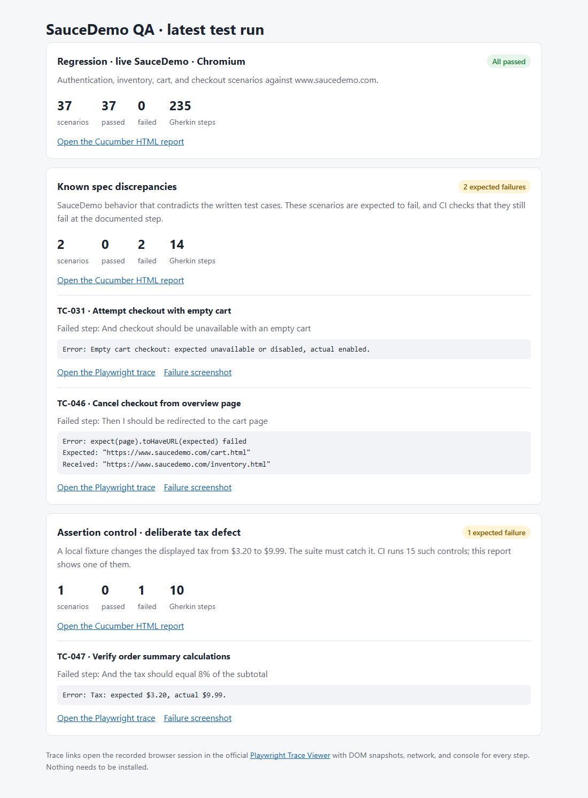

# SauceDemo · QA and test automation portfolio

[](https://github.com/vmurashev365/saucedemo/actions/workflows/qa.yml)
[](https://vmurashev365.github.io/saucedemo/)

End-to-end QA of the [SauceDemo](https://www.saucedemo.com/) online store. The work starts from a written test strategy and manual test cases. It ends with a BDD automation suite that runs in CI and publishes its report.

## What this project shows

- **Requirements-driven testing.** A test strategy, a user story map, and manual test cases come first. Every automated checkout check traces back to a numbered test case.
- **Real findings.** The suite found two places where SauceDemo contradicts its test cases. Both are documented with reproduction steps and screenshots. CI confirms on every push, and weekly, that they still reproduce.
- **Tests that are proven to fail.** A local copy of the checkout injects 15 deliberate defects, such as a wrong tax or a lost cart item. Each defect must fail the expected step with the expected message.
- **Failures that explain themselves.** A failure produces a message such as `Tax: expected $3.20, actual $9.99.`, a screenshot, and a Playwright trace grouped by Gherkin step.
- **CI with a public report.** GitHub Actions runs the type check, the live regression, the discrepancy check, and the assertion controls. The [latest report](https://vmurashev365.github.io/saucedemo/) opens in the browser, and each trace opens in the Playwright Trace Viewer.

[](https://vmurashev365.github.io/saucedemo/)

## Findings

| Case | Expected by the test case | Actual SauceDemo behavior | Evidence |
| --- | --- | --- | --- |
| **TC-046** · Cancel on the checkout overview | Return to the cart with both items unchanged | Opens Products instead. The items stay in the cart. | [QA note](test_documents/checkout-cancel-qa-note.md) · [Screenshot](test_documents/checkout-evidence/cancel-overview-after.png) |
| **TC-031** · Checkout with an empty cart | Checkout is absent or disabled | Checkout is enabled and opens the information form | [Review](test_documents/checkout-review.md#requirements-and-results) · [Screenshot](test_documents/checkout-evidence/empty-cart-after-checkout.png) |

Both scenarios are tagged `@known-spec-discrepancy` and run separately from the regression suite. `npm run test:discrepancies` passes while both still fail at the documented step. It fails if SauceDemo changes, so the documentation never silently goes stale.

## Coverage

| Feature | Scenarios | What is checked |
| --- | ---: | --- |
| [Authentication](tests/features/login.feature) | 10 | Valid accounts, locked-out user, invalid credentials, required fields |
| [Inventory](tests/features/inventory.feature) | 11 | Product details, four sort orders, cart badge, Add and Remove buttons |
| [Cart](tests/features/cart.feature) | 8 | Exact items, prices and quantities, removal, navigation, empty cart rules |
| [Checkout](tests/features/checkout.feature) | 10 | Order completion, subtotal, 8% tax and total in cents, form validation, cancellation |
| **Total** | **39** | 37 in the regression suite and 2 known discrepancies |

## Manual QA artifacts

| Artifact | Contents |
| --- | --- |
| [Test strategy](test_documents/Test%20Strategy%20Document%20-%20SauceDemo.pdf) | Scope, approach, priorities, and risks |
| [User story mapping](test_documents/User%20Story%20Mapping%20-%20SauceDemo.pdf) | Customer journeys across the store |
| [Manual test cases](test_documents/Test%20Cases%20-%20SauceDemo%20E-commerce%20Platform.pdf) | Steps and expected results for each case |
| [Cart and checkout review](test_documents/checkout-review.md) | Each business rule mapped to its automation and the live result |
| [Original automation results](test_documents/baseline-2025-08/README.md) | The August 2025 run and the root cause of each of its six failures |

## Tech stack

Playwright 1.65 · TypeScript 7 · Cucumber 13 with Gherkin · Page Object Model · Node.js 24 · GitHub Actions · GitHub Pages

```text
src/pages/              Page objects for each SauceDemo page
src/utils/              Exact money parsing and checkout assertions
tests/features/         Gherkin feature files
tests/step-definitions/ Step definitions
tests/hooks/            Browser lifecycle, screenshots, and traces
tests/local/            Local checkout fixture and the 15 assertion controls
test_documents/         Strategy, test cases, findings, and evidence
```

## Run it locally

Requires Node.js 24 and npm.

```sh
npm ci
npx playwright install chromium
npm test                        # 37 regression scenarios against the live site, headless
npm run test:discrepancies      # confirms that both findings still reproduce
npm run test:checkout:controls  # 15 deliberate defects must each be caught
```

Add `HEADED=true` to watch the browser. [Running the tests](docs/running-tests.md) covers every command, environment variable, tag, and report.
