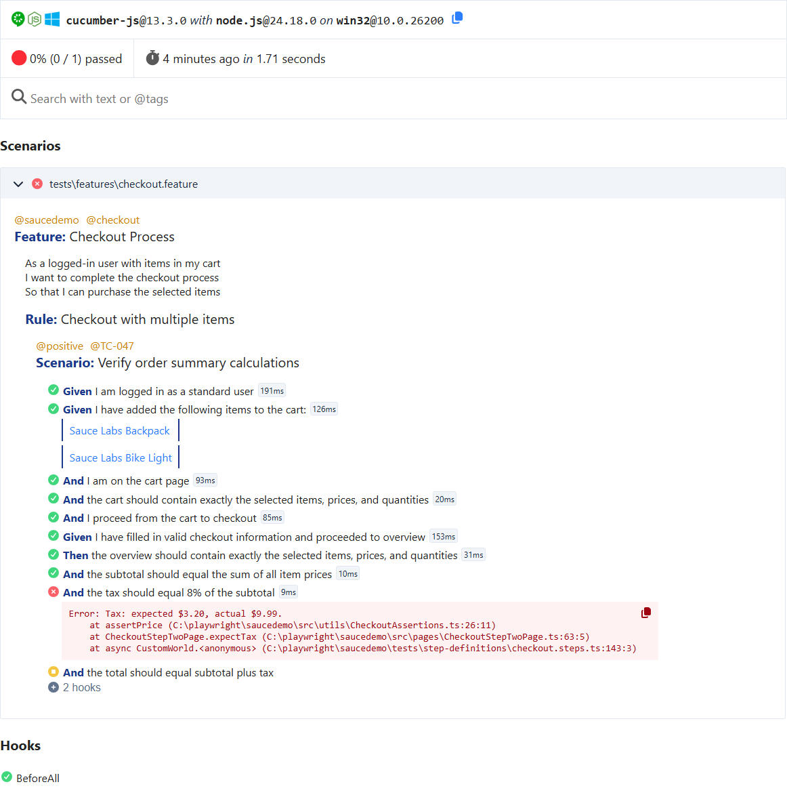

# Running the tests

Reference for every command, setting, and report in this repository. For the project overview, see the [README](../README.md).

## Install and verify

Use Node.js 24.x, npm, and Git. Run these commands from the repository root.

```sh
npm ci
npm run typecheck
npm run bdd:dry
npx playwright install chromium
npm test
```

`npm run bdd:dry` checks that all 39 scenarios bind to step definitions without opening a browser. `npm test` runs the 37 regression scenarios against the live site in headless Chromium.

## Commands

| Command | What it runs |
| --- | --- |
| `npm test` | Regression suite: every scenario except `@skip` and `@known-spec-discrepancy` |
| `npm run test:all` | All 39 scenarios. Exits 1 while the two known discrepancies remain |
| `npm run test:smoke` | The four `@smoke` scenarios. Fails if the tag expression collects no scenario |
| `npm run test:discrepancies` | The two `@known-spec-discrepancy` scenarios. Passes only while both fail at the documented step with the documented diagnostic |
| `npm run test:checkout:local` | Seven checkout scenarios against a local fixture that behaves correctly |
| `npm run test:checkout:controls` | Fifteen deliberate defects in the local fixture. Passes when each one fails the expected step |
| `npm run test:chrome`, `test:firefox`, `test:safari` | Regression suite in Chromium, Firefox, or WebKit, the engine behind Safari |
| `npm run test:headed` | Regression suite in a visible browser window |
| `npm run test:debug` | Visible browser with page console output, video, and HAR recording |
| `npm run test:login`, `test:inventory`, `test:cart`, `test:checkout` | One feature area |
| `npm run test:positive`, `test:negative` | Positive or negative scenarios |
| `npm run typecheck` | TypeScript check of all test code |
| `npm run bdd:dry` | Step discovery for all 39 scenarios without a browser |
| `npm run clean` | Removes generated reports, screenshots, videos, and HAR files |

Pass extra Cucumber options after `--`. A CLI tag filter is combined with the base tag expression.

```sh
npm test -- --tags "@smoke and @positive"
npm run test:all -- --tags @checkout
npx cucumber-js --profile file tests/features/login.feature
```

Use `--profile file` to select a feature path or line. Cucumber 13 otherwise combines CLI paths with the configured glob. [Cucumber path configuration](https://github.com/cucumber/cucumber-js/blob/v13.3.0/docs/deprecations.md#paths-in-configuration-and-cli)

## Environment variables

| Variable | Default | Effect |
| --- | --- | --- |
| `BROWSER` | `chromium` | Selects `chromium`, `firefox`, or `webkit` |
| `HEADED` | `false` | Set to `true` to show the browser window |
| `SLOW_MO` | `0` | Delays each browser action by this many milliseconds, useful for demos |
| `DEBUG` | `false` | Set to `true` to record console output, video, and HAR |
| `BASE_URL` | `https://www.saucedemo.com` | Selects the SauceDemo deployment |
| `VIEWPORT` | `1920x1080` | Sets the viewport. A headed Chromium window opens maximized instead |
| `TIMEOUT` | `30000` | Playwright action, navigation, and assertion timeout in milliseconds. Each Cucumber step gets one more second so Playwright can report its own error first |
| `TAGS` | `not @skip and not @known-spec-discrepancy` | Replaces the base tag expression. The `all` profile uses `not @skip` |
| `REPORT_DIR` | `reports` | Output directory for the HTML and JSON reports, screenshots, and traces |
| `SHOW_GHERKIN_PROGRESS` | `true` | Set to `false` to hide live step progress and keep the standard Cucumber summary |

In PowerShell:

```powershell
$env:HEADED = 'true'; $env:SLOW_MO = '300'
npm run test:checkout
Remove-Item Env:HEADED, Env:SLOW_MO
```

In Bash or another POSIX shell:

```sh
HEADED=true SLOW_MO=300 npm run test:checkout
```

## Reports and diagnostics

Each run writes `cucumber-report.html` and `cucumber-report.json` to `REPORT_DIR`. A new run overwrites the previous report in the same directory.

The terminal prints each scenario name, then each Gherkin step with its status and duration. Terminals with color support show `PASS` in green, `FAILED` in red, and `SKIPPED` in yellow. Set `NO_COLOR=1` for plain text. At the end of a failing run, every step of each failed scenario is listed in order, with the step definition location and the full diagnostic for the failed step.

When a scenario fails:

- A full-page screenshot is saved under `screenshots/` in the report directory and embedded in the HTML report.
- A Playwright trace with actions grouped by Gherkin step is saved under `traces/`. Open it with `npx playwright show-trace <path-to-trace.zip>`, or drop the file onto [trace.playwright.dev](https://trace.playwright.dev/).
- A JSON attachment in the report records the page URL and the screenshot and trace paths.

Debug runs also write videos to `videos/` and the latest HAR to `har/trace.har`.



## Checkout assertion controls

The live suite can only show that the checks pass on a working site. The controls show that the same Gherkin steps and page objects fail when the checkout is wrong. They run against a loopback HTML fixture that imitates the SauceDemo checkout.

```sh
npm run test:checkout:local
npm run test:checkout:controls
```

The first command runs seven scenarios with correct fixture behavior: both two-item cancellations, cart clearing after Back Home, and both empty-cart rules. The second injects one defect at a time: wrong, hidden, missing, blank, or duplicated row fields, a wrong tax, a cancellation that drops an item, a cart that survives the order, and a disabled Continue Shopping button. It also runs the smoke command on a failing scenario. Each command exits 0 only when every failing step, diagnostic, screenshot, trace, and child exit code matches the expectation.

Reports go to `reports/business/local/<control>/`, each with `cucumber-report.html` and a `checks.json` summary. [Control details](../test_documents/checkout-review.md#local-assertion-controls)

## Continuous integration

[The QA workflow](../.github/workflows/qa.yml) runs on every push to `master`, on pull requests, weekly on Monday, and on demand. Its three jobs run in parallel:

| Job | Command | Purpose |
| --- | --- | --- |
| Regression · live site · Chromium | `npm run typecheck`, `npm run bdd:dry`, `npm test` | Type and step checks, then the 37 regression scenarios |
| Known spec discrepancies | `npm run test:discrepancies` | Confirms that TC-031 and TC-046 still reproduce as documented |
| Assertion controls · local fixture | `npm run test:checkout:local`, `npm run test:checkout:controls` | Proves that the checks catch deliberate checkout defects |

Each job uploads its Cucumber report as an artifact. After a run on `master`, [the publish workflow](../.github/workflows/pages.yml) deploys the reports and a [summary page](../.github/report-site/index.html) to [GitHub Pages](https://vmurashev365.github.io/saucedemo/). Pull request runs are never published.
